<div align="center">

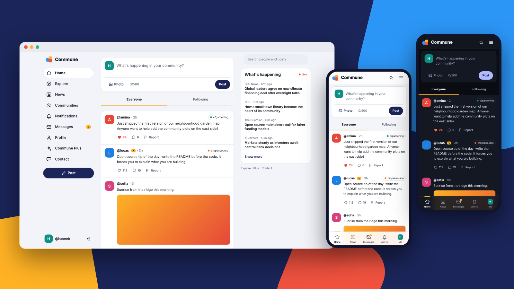

# Commune

**An open-source community platform for the MERN stack. Posts, communities, live news, private messages and creator payments, in one TypeScript monorepo.**

[**Live demo**](https://commune-mu.vercel.app) · [Documentation](docs/) · [Report a bug](https://github.com/Haseeb-MernStack/commune/issues) · [Request a feature](https://github.com/Haseeb-MernStack/commune/issues)

[](https://github.com/Haseeb-MernStack/commune/actions/workflows/ci.yml)
[](LICENSE)
[](CONTRIBUTING.md)
[](https://commune-mu.vercel.app)


</div>

---

## Contents

- [Commune](#commune)
  - [Contents](#contents)
  - [Screenshots](#screenshots)
    - [Desktop](#desktop)
    - [Mobile](#mobile)
  - [Features](#features)
  - [Tech stack](#tech-stack)
  - [Architecture](#architecture)
  - [Getting started](#getting-started)
    - [Become an admin](#become-an-admin)
  - [Environment variables](#environment-variables)
  - [Scripts](#scripts)
  - [Testing](#testing)
  - [Deployment](#deployment)
  - [API overview](#api-overview)
  - [Roadmap](#roadmap)
  - [Contributing](#contributing)
  - [License](#license)

## Screenshots

> The images below are renders of the real stylesheet with sample data. Open the [live demo](https://commune-mu.vercel.app) to see the real thing.

### Desktop

| Home feed | Dark mode |
| :---: | :---: |
| 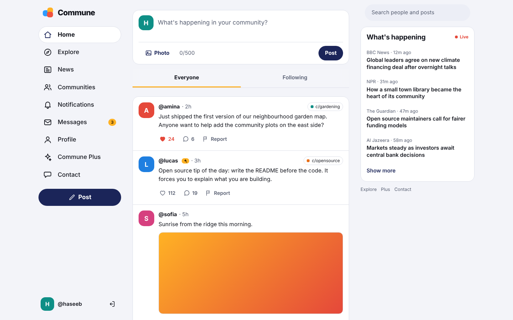 | 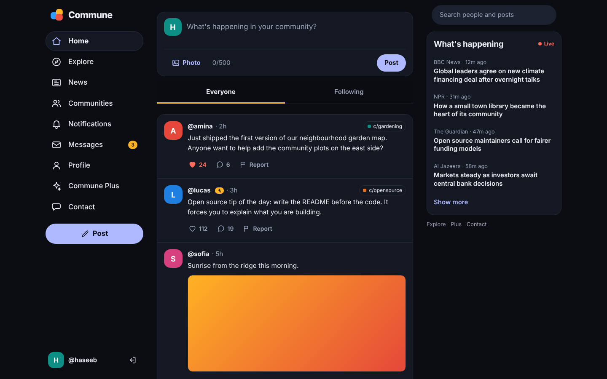 |

| Messages | Commune Plus |
| :---: | :---: |
| 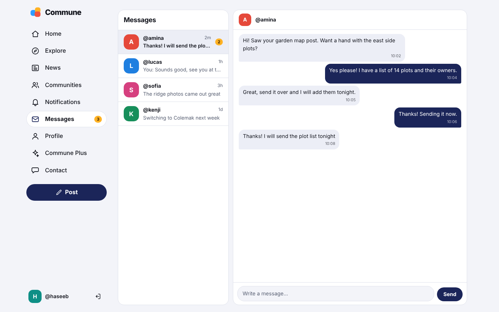 | 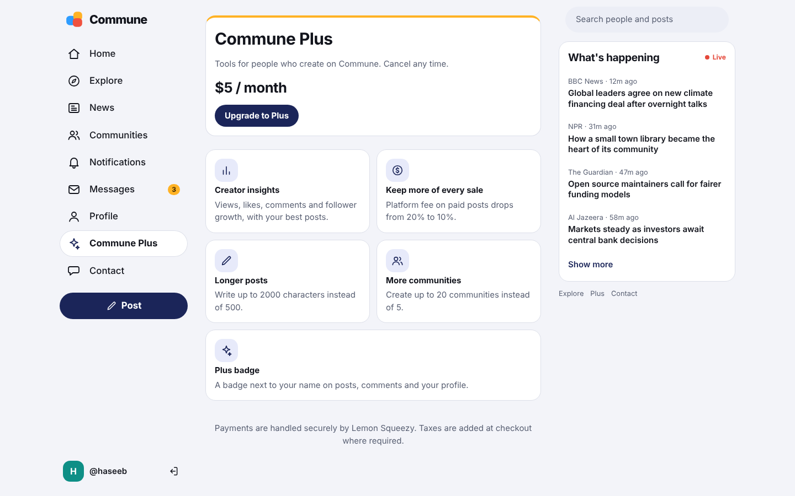 |

| Landing | Sign in |
| :---: | :---: |
| 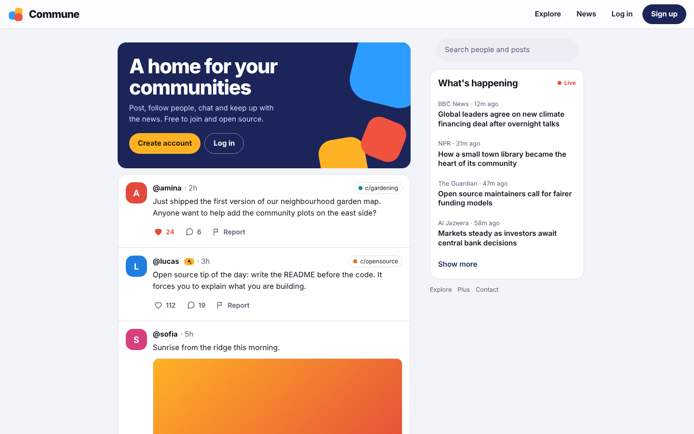 | 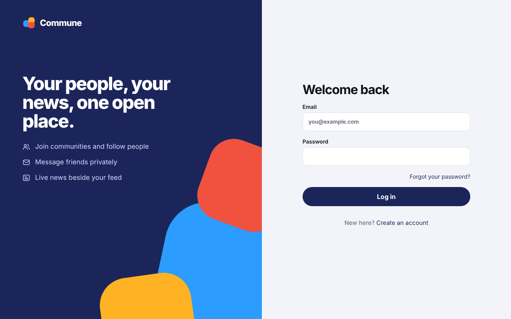 |

### Mobile

<table>
  <tr>
    <td align="center">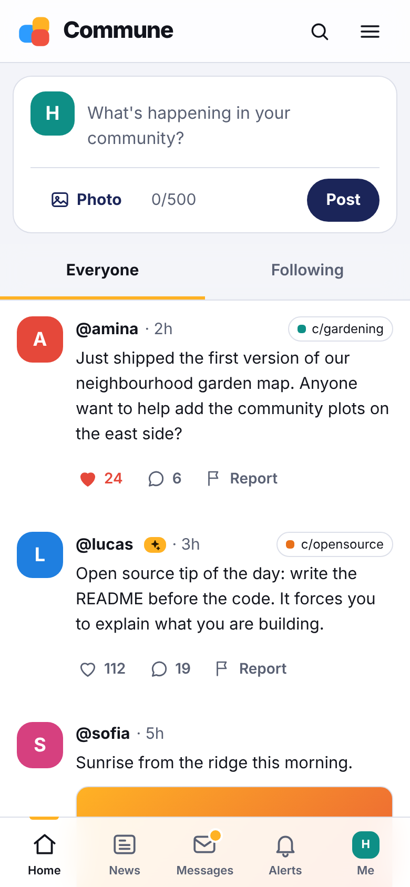<br/><sub>Feed</sub></td>
    <td align="center">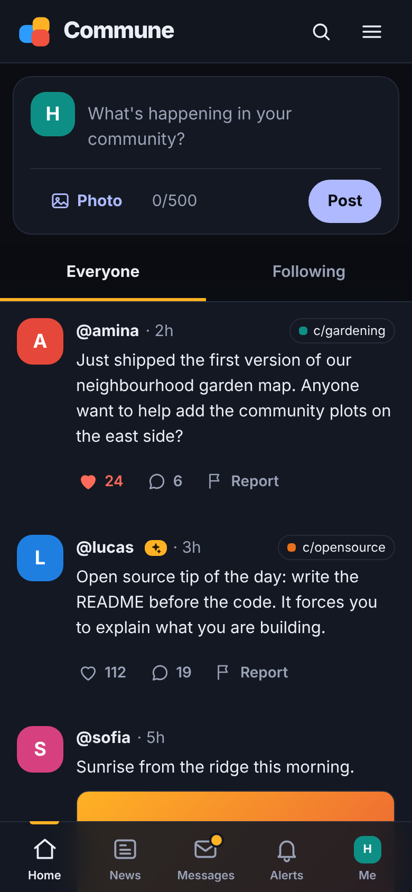<br/><sub>Dark</sub></td>
    <td align="center">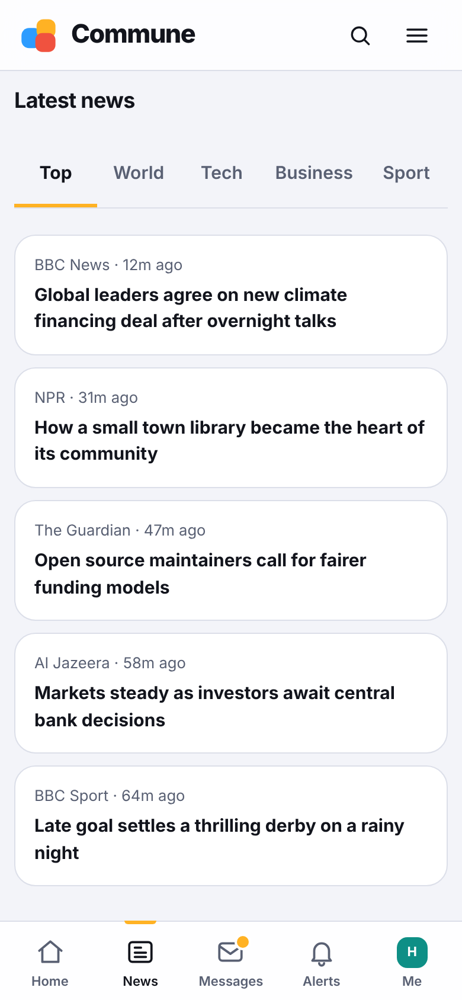<br/><sub>News</sub></td>
    <td align="center">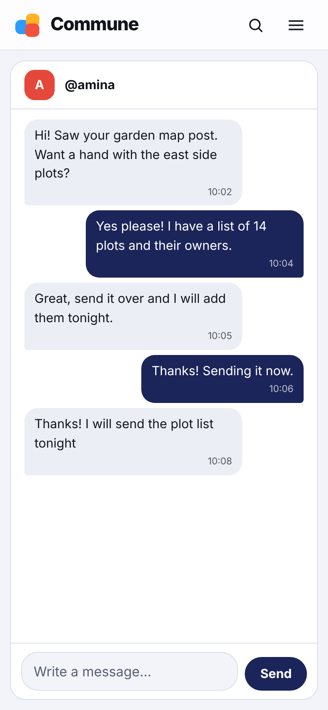<br/><sub>Messages</sub></td>
    <td align="center">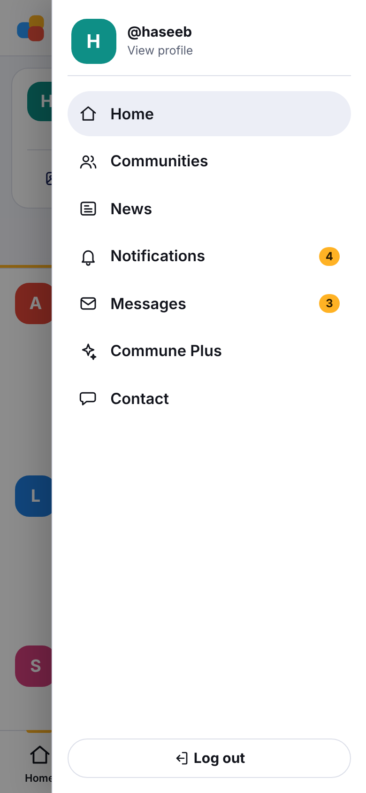<br/><sub>Menu</sub></td>
  </tr>
</table>

## Features

**Social**
- Posts with photos, likes, comments and reports
- Follow people, profiles with avatars and bios, notifications
- Communities (`c/name`) with their own feeds
- Full-text search across people and posts
- Direct messages (polling, so it works on serverless hosting)

**Live news**
- Right-rail "What's happening" panel and a News page with topics (top, world, technology, business, sport)
- RSS feeds parsed on the server and cached, so the page stays fast

**Money**
- Paid posts through [Lemon Squeezy](https://www.lemonsqueezy.com), with a platform fee and creator balance
- **Commune Plus**, a recurring subscription: insights, a lower fee, longer posts, more communities and a badge
- Optional Google AdSense slots on Explore

**Accounts and safety**
- Email and password, plus Sign in with Google
- Short-lived access token in memory, rotating httpOnly refresh cookie
- Email verification and password reset (Resend)
- Moderation: reports, an admin page, suspensions
- Rate limiting, helmet, Zod validation on every write

**Experience**
- Responsive layout: three columns on desktop, bottom tab bar and drawer on mobile
- Light and dark theme, installable PWA
- Image upload that shrinks on the device and uploads straight to Cloudinary
- Lazy-loaded routes, early data fetching and cached sessions for fast first paint

## Tech stack

| Layer | Tools |
| --- | --- |
| Web | React 18, Vite 5, React Router 6, TanStack Query 5, plain CSS design tokens |
| API | Node.js, Express 4, Mongoose 8, Zod, JWT, bcryptjs, helmet, express-rate-limit, pino, multer |
| Shared | `packages/shared`: Zod schemas and DTO types used by both sides |
| Database | MongoDB (Atlas in production) |
| Services | Cloudinary (images), Resend (email), Lemon Squeezy (payments), Google Identity |
| Tooling | TypeScript, npm workspaces, tsup, tsx, Vitest, Supertest, Prettier, GitHub Actions |
| Hosting | Vercel (two projects: web and API) |

## Architecture

```
commune/
├── apps/
│   ├── web/          React single-page app (Vite)
│   │   └── src/      pages, components, hooks, lib (api client, upload), store, styles
│   └── api/          Express API
│       └── src/      routes, controllers, services, models, middleware, tests
├── packages/
│   └── shared/       Zod schemas and types shared by web and api
├── docs/             architecture, deployment, design, uploads, performance, Plus
└── docker-compose.yml  local MongoDB
```

```
Browser ──► Vercel (web) ──/api/* rewrite──► Vercel (API, Express) ──► MongoDB Atlas
                                                        ├──► Cloudinary   images
                                                        ├──► Resend       email
                                                        └──► Lemon Squeezy  payments + webhooks
```

The web app calls `/api/...` on its own domain and Vercel rewrites it to the API project, so the refresh cookie stays first-party. More detail in [docs/ARCHITECTURE.md](docs/ARCHITECTURE.md).

## Getting started

Requirements: Node.js 20+, npm 10+, and either Docker or a MongoDB connection string.

```bash
git clone https://github.com/Haseeb-MernStack/commune.git
cd commune

cp .env.example .env          # Windows PowerShell: Copy-Item .env.example .env
docker compose up -d mongo    # or point MONGODB_URI at your own MongoDB
npm install
npm run dev
```

- Web: http://localhost:5173
- API: http://localhost:4000/api

With the optional keys left blank, development still works: emails are printed in the API log, purchases are simulated and images are stored on disk.

### Become an admin

Register an account, then:

```bash
npm run make-admin -w @commune/api -- you@example.com
```

## Environment variables

Copy `.env.example` to `.env` (never commit it). Required to run:

| Variable | Purpose |
| --- | --- |
| `MONGODB_URI` | MongoDB connection string |
| `JWT_ACCESS_SECRET` | 32+ character secret for access tokens |
| `CLIENT_ORIGIN` | Web origin allowed by CORS, no trailing slash |

Optional features:

| Variable | Enables |
| --- | --- |
| `CLOUDINARY_CLOUD_NAME`, `CLOUDINARY_API_KEY`, `CLOUDINARY_API_SECRET` | Image storage in production |
| `RESEND_API_KEY`, `EMAIL_FROM` | Verification and reset emails |
| `LEMONSQUEEZY_API_KEY`, `LEMONSQUEEZY_STORE_ID`, `LEMONSQUEEZY_VARIANT_ID`, `LEMONSQUEEZY_WEBHOOK_SECRET` | Paid posts |
| `LEMONSQUEEZY_PLUS_VARIANT_ID`, `PLUS_PRICE_LABEL`, `PLUS_FEE_PERCENT` | Commune Plus |
| `PLATFORM_FEE_PERCENT` | Platform share of paid posts |
| `GOOGLE_CLIENT_ID`, `VITE_GOOGLE_CLIENT_ID` | Sign in with Google |
| `VITE_ADSENSE_CLIENT`, `VITE_ADSENSE_FEED_SLOT` | AdSense |
| `CONTACT_EMAIL` | Also email contact-form messages |
| `REQUIRE_VERIFIED_EMAIL` | Force verified email before interacting |
| `TRUST_PROXY` | Reverse proxy count (2 on Vercel) |

`VITE_*` values are baked into the web build, so redeploy the web project after changing them.

## Scripts

| Command | What it does |
| --- | --- |
| `npm run dev` | API and web with hot reload |
| `npm run typecheck` | TypeScript check for shared, api and web |
| `npm test` | API tests |
| `npm run build` | Production build of api and web |
| `npm run format` | Prettier |

## Testing

```bash
npm run typecheck
npm test
```

API tests use Vitest and Supertest with mocked models, so they need no database. CI runs the same checks on every push and pull request.

## Deployment

Commune runs as **two Vercel projects** from this one repository, plus MongoDB Atlas.

| Project | Root directory | Notes |
| --- | --- | --- |
| Web | `apps/web` | Rewrites `/api/*` and `/uploads/*` to the API project |
| API | `apps/api` | Build command `npm run build:vercel`, function `api/index.js` |

Step-by-step setup, environment variables and a troubleshooting list are in [docs/DEPLOYMENT.md](docs/DEPLOYMENT.md).

## API overview

All routes are under `/api`.

| Area | Examples |
| --- | --- |
| Auth | `POST /auth/register`, `/auth/login`, `/auth/refresh`, `/auth/logout`, `/auth/google` |
| Posts | `GET /posts`, `POST /posts`, `POST /posts/:id/like`, `POST /posts/:id/comments` |
| People | `GET /users/:username`, `POST /users/:username/follow` |
| Communities | `GET /communities`, `POST /communities`, `POST /communities/:slug/join` |
| Messages | `GET /messages`, `POST /messages/with/:username`, `GET /messages/unread-count` |
| News | `GET /news?topic=technology` |
| Uploads | `POST /uploads/sign`, `POST /uploads/complete`, `POST /uploads` |
| Payments | `GET /billing`, `POST /billing/portal`, `POST /webhooks/lemonsqueezy` |
| Admin | Reports and user moderation |

See `apps/api/src/routes/index.ts` for the full list.

## Roadmap

- [x] Auth, profiles, follows, notifications
- [x] Image uploads, search, moderation
- [x] Email verification and password reset
- [x] Paid posts and Commune Plus
- [x] Communities, live news, direct messages
- [x] PWA, responsive design, dark mode
- [ ] Block and report inside messages
- [ ] Real-time notifications
- [ ] Hashtags and trending
- [ ] Internationalisation

## Contributing

Contributions are welcome. Read [CONTRIBUTING.md](CONTRIBUTING.md), open an issue to discuss larger changes, and make sure `npm run typecheck` and `npm test` pass before opening a pull request.

## License

[MIT](LICENSE)

<div align="center"><sub>Built with the MERN stack. If Commune helps you, consider giving it a ⭐</sub></div>
