<div align="center">

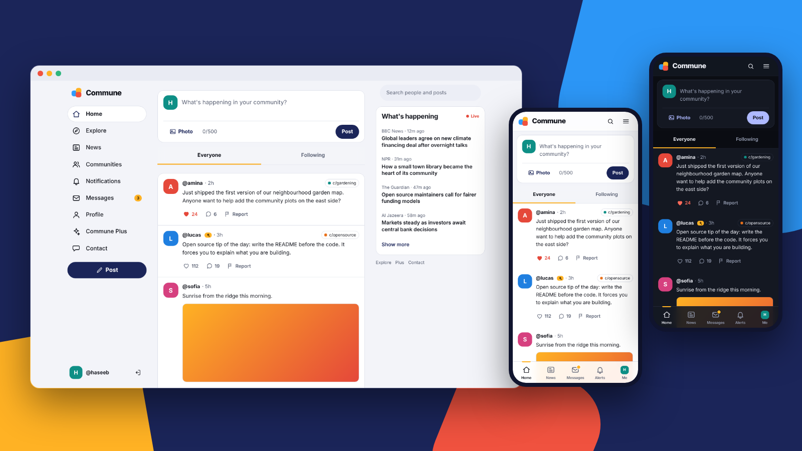

# Commune

**An open-source community platform for the MERN stack. Posts, communities, live news, real-time messages, push notifications and creator payments, in one TypeScript monorepo.**

[**Live demo**](https://commune-mu.vercel.app) · [Documentation](docs/) · [Report a bug](https://github.com/Haseeb-MernStack/commune/issues) · [Request a feature](https://github.com/Haseeb-MernStack/commune/issues)

[](https://github.com/Haseeb-MernStack/commune/actions/workflows/ci.yml)
[](LICENSE)
[](CONTRIBUTING.md)
[](https://commune-mu.vercel.app)


</div>

---

## Contents

- [Commune](#commune)
  - [Contents](#contents)
  - [Screenshots](#screenshots)
    - [Desktop](#desktop)
    - [Mobile](#mobile)
  - [Features](#features)
  - [Tech stack](#tech-stack)
  - [Architecture](#architecture)
  - [Getting started](#getting-started)
    - [Become an admin](#become-an-admin)
  - [Environment variables](#environment-variables)
  - [Scripts](#scripts)
  - [Testing and CI](#testing-and-ci)
  - [Security](#security)
  - [Monitoring](#monitoring)
  - [Deployment](#deployment)
  - [API overview](#api-overview)
  - [Roadmap](#roadmap)
  - [Documentation](#documentation)
  - [Contributing](#contributing)
  - [License](#license)

## Screenshots

> The images below are renders of the real stylesheet with sample data. Open the [live demo](https://commune-mu.vercel.app) to see the real thing.

### Desktop

| Home feed | Dark mode |
| :---: | :---: |
| 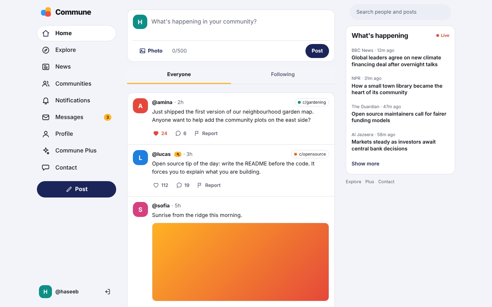 | 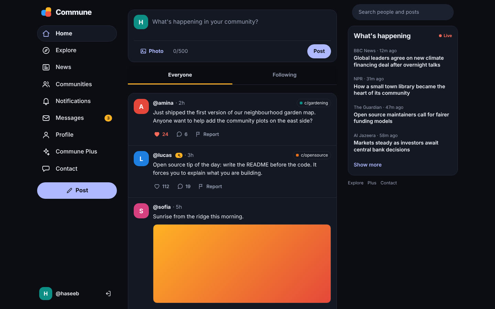 |

| Messages | Commune Plus |
| :---: | :---: |
| 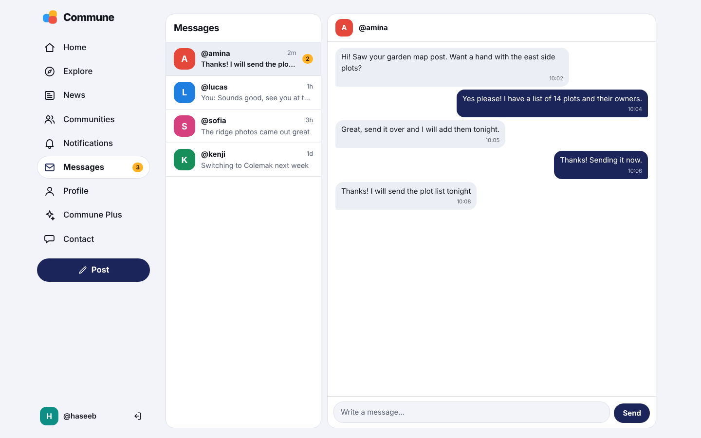 | 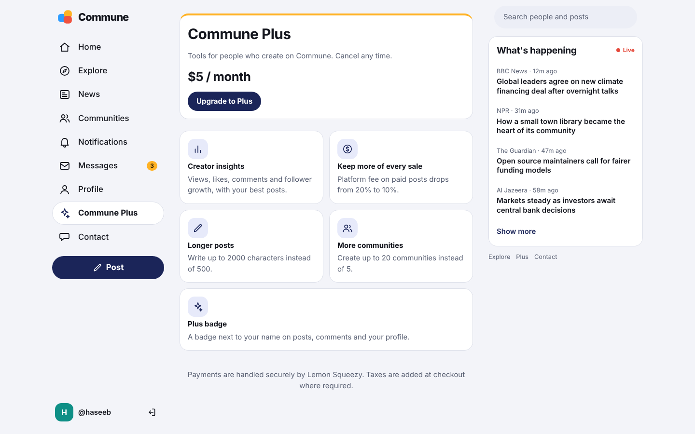 |

| Landing | Sign in |
| :---: | :---: |
| 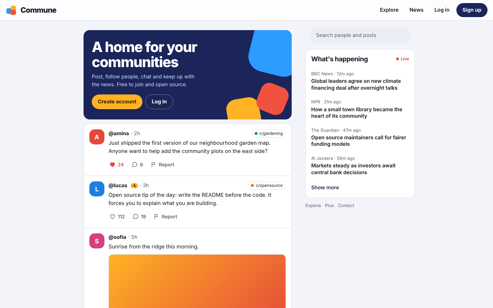 | 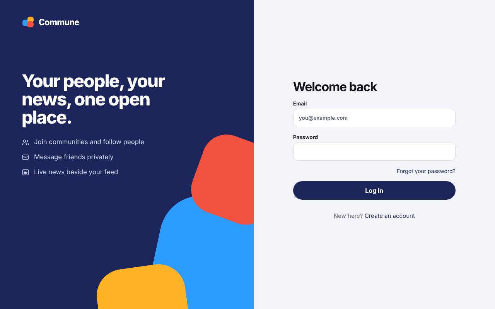 |

### Mobile

<table>
  <tr>
    <td align="center">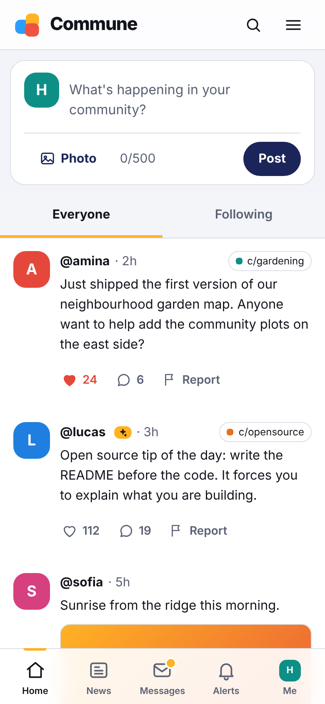<br/><sub>Feed</sub></td>
    <td align="center">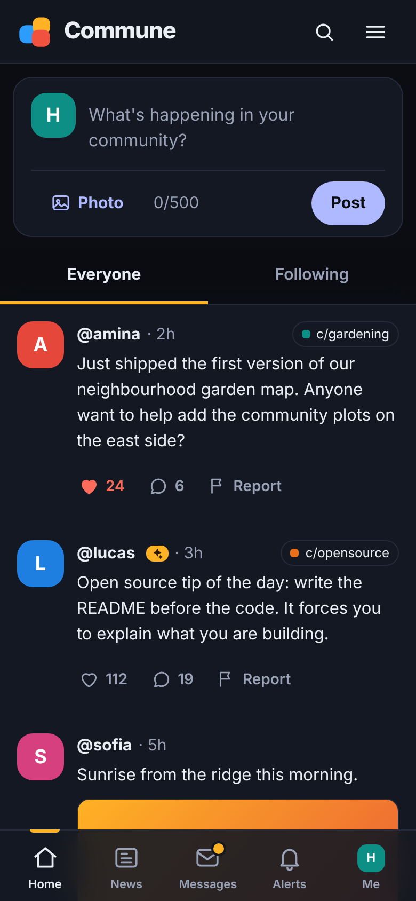<br/><sub>Dark</sub></td>
    <td align="center">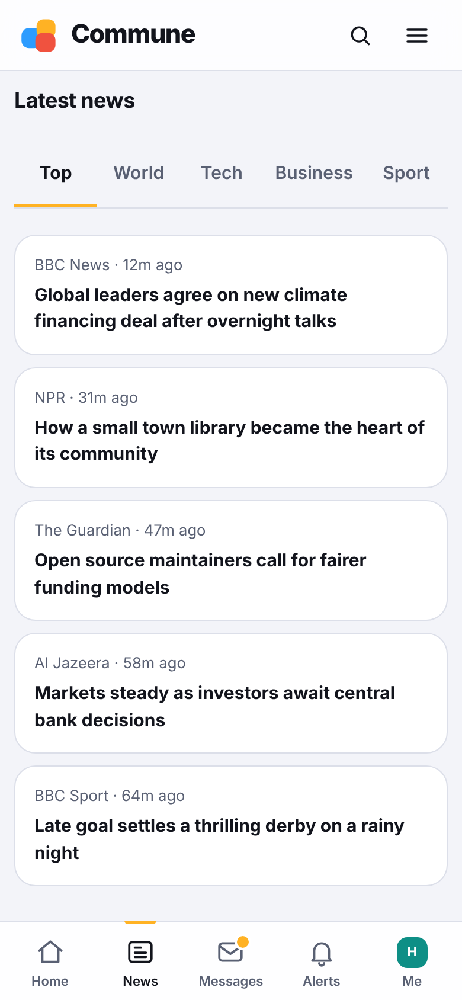<br/><sub>News</sub></td>
    <td align="center">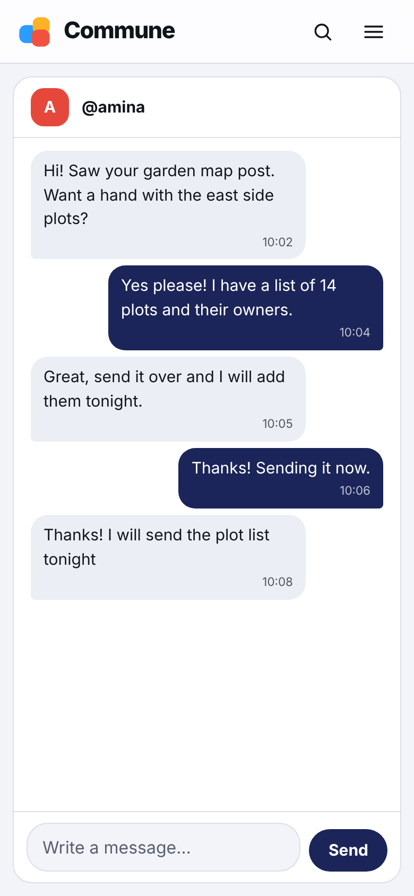<br/><sub>Messages</sub></td>
    <td align="center">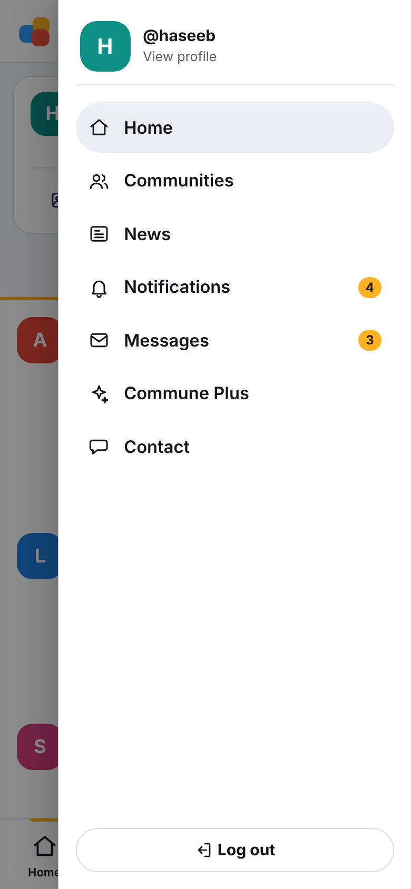<br/><sub>Menu</sub></td>
  </tr>
</table>

## Features

**Social**
- Posts with photos, likes, comments and reports
- Follow people, profiles with avatars and bios, notifications
- Communities (`c/name`) with their own feeds
- Full-text search across people and posts

**Real time**
- Direct messages over Socket.IO: instant delivery, typing indicator, "seen" ticks and online status, with optimistic sending
- Falls back to polling when the live connection is down and catches up when it returns
- Web push notifications for messages, likes, comments and followers, even when the app is closed (Android, desktop, and iPhone once installed to the Home Screen)
- Notification sounds with a volume control, quiet while you are already reading the conversation

**Live news**
- Right-rail "What's happening" panel with the 4 latest headlines, and a News page with topics (top, world, technology, business, sport)
- RSS feeds parsed on the server and cached in memory and in MongoDB, so a cold start never waits on the publishers

**Money**
- Paid posts through [Lemon Squeezy](https://www.lemonsqueezy.com), with a platform fee and creator balance
- **Commune Plus**, a recurring subscription: insights, a lower fee, longer posts, more communities and a badge, with a customer portal, failed-payment handling and clear status
- Test and live payments kept apart, so a test card can never unlock Plus on the real site
- Optional Google AdSense slots on Explore

**Accounts and safety**
- Email and password, plus Sign in with Google
- Short-lived access token in memory, rotating httpOnly refresh cookie, login lockout after repeated failures
- Email verification and password reset (Resend)
- Moderation: reports, an admin page, suspensions
- Rate limiting, helmet, Zod validation on every write, same-origin checks, log redaction

**Experience**
- Responsive layout: three columns on desktop, bottom tab bar and drawer on mobile
- Light and dark theme, installable PWA
- Instagram-style skeleton loading, endless scroll, and pages prefetched before you tap them
- Image upload that shrinks on the device and uploads straight to Cloudinary
- Lazy-loaded routes, early data fetching and cached sessions for fast first paint

**Operations**
- Error tracking in the admin page (grouped, with email alerts for new errors) and browser error reporting
- Health and readiness endpoints, request ids on every response

## Tech stack

| Layer | Tools |
| --- | --- |
| Web | React 18, Vite, React Router 6, TanStack Query 5, plain CSS design tokens, service worker |
| API | Node.js, Express 4, Mongoose 8, Zod, JWT, bcryptjs, helmet, express-rate-limit, pino, multer |
| Realtime | Node.js, Socket.IO 4, JWT verification, an always-on service (`apps/realtime`) |
| Shared | `packages/shared`: Zod schemas and DTO types used by web, api and realtime |
| Database | MongoDB (Atlas in production) |
| Services | Cloudinary (images), Resend (email), Lemon Squeezy (payments), Google Identity, Web Push (VAPID) |
| Tooling | TypeScript, npm workspaces, tsup, tsx, Vitest, Supertest, Prettier, GitHub Actions, CodeQL, Dependabot |
| Hosting | Vercel (web and API), plus one small always-on host for the realtime service (a Render blueprint is included) |

## Architecture

```
commune/
├── apps/
│   ├── web/          React single-page app (Vite)
│   │   └── src/      pages, components, hooks, lib (api client, realtime, push, sound), store, styles
│   ├── api/          Express API
│   │   └── src/      routes, controllers, services, models, middleware, tests
│   └── realtime/     Socket.IO service (messages, typing, presence, notification events)
├── packages/
│   └── shared/       Zod schemas and types shared by web, api and realtime
├── docs/             architecture, deployment, security, monitoring, realtime, push, Plus, design
├── render.yaml       blueprint for the realtime service
└── docker-compose.yml  local MongoDB
```

```
Browser ──► Vercel (web) ──/api/* rewrite──► Vercel (API, Express) ──► MongoDB Atlas
   │                                                 ├──► Cloudinary     images
   │                                                 ├──► Resend         email
   │                                                 ├──► Lemon Squeezy  payments + webhooks
   │                                                 ├──► Push services  web push (VAPID)
   │                                                 └──► POST /internal/emit
   └──── WebSocket ──► Realtime service (Socket.IO) ◄───────────┘
```

The web app calls `/api/...` on its own domain and Vercel rewrites it to the API project, so the refresh cookie stays first-party. The REST API stays the source of truth: serverless functions cannot hold WebSocket connections, so a small always-on service pushes live events to browsers, and the app keeps working by polling if it is down. More detail in [docs/ARCHITECTURE.md](docs/ARCHITECTURE.md) and [docs/REALTIME.md](docs/REALTIME.md).

## Getting started

Requirements: Node.js 20+, npm 10+, and either Docker or a MongoDB connection string.

```bash
git clone https://github.com/Haseeb-MernStack/commune.git
cd commune

cp .env.example .env          # Windows PowerShell: Copy-Item .env.example .env
docker compose up -d mongo    # or point MONGODB_URI at your own MongoDB
npm install
npm run dev
```

- Web: http://localhost:5173
- API: http://localhost:4000/api

With the optional keys left blank, development still works: emails are printed in the API log, purchases are simulated, images are stored on disk and messages use polling. To run the realtime service locally, see [docs/REALTIME.md](docs/REALTIME.md).

### Become an admin

Register an account, then:

```bash
npm run make-admin -w @commune/api -- you@example.com
```

## Environment variables

Copy `.env.example` to `.env` (never commit it). Required to run:

| Variable | Purpose |
| --- | --- |
| `MONGODB_URI` | MongoDB connection string |
| `JWT_ACCESS_SECRET` | 32+ character secret for access tokens |
| `CLIENT_ORIGIN` | Web origin allowed by CORS, no trailing slash |

Optional features:

| Variable | Enables |
| --- | --- |
| `CLOUDINARY_CLOUD_NAME`, `CLOUDINARY_API_KEY`, `CLOUDINARY_API_SECRET` | Image storage in production |
| `RESEND_API_KEY`, `EMAIL_FROM` | Verification and reset emails |
| `LEMONSQUEEZY_API_KEY`, `LEMONSQUEEZY_STORE_ID`, `LEMONSQUEEZY_VARIANT_ID`, `LEMONSQUEEZY_WEBHOOK_SECRET` | Paid posts |
| `LEMONSQUEEZY_PLUS_VARIANT_ID`, `PLUS_PRICE_LABEL`, `PLUS_FEE_PERCENT` | Commune Plus |
| `LEMONSQUEEZY_ACCEPT_TEST_MODE` | `true` only while testing payments; leave `false` on the real site |
| `PLATFORM_FEE_PERCENT` | Platform share of paid posts |
| `GOOGLE_CLIENT_ID`, `VITE_GOOGLE_CLIENT_ID` | Sign in with Google |
| `VITE_ADSENSE_CLIENT`, `VITE_ADSENSE_FEED_SLOT` | AdSense |
| `CONTACT_EMAIL` | Also email contact-form messages |
| `REQUIRE_VERIFIED_EMAIL` | Force verified email before interacting |
| `REALTIME_URL`, `REALTIME_SECRET` (API) and `VITE_REALTIME_URL` (web) | Real-time messages; `REALTIME_SECRET` is shared by the API and the realtime service |
| `VAPID_PUBLIC_KEY`, `VAPID_PRIVATE_KEY`, `VAPID_SUBJECT` | Web push notifications (generate keys with `npx web-push generate-vapid-keys`) |
| `ALERT_EMAIL` | Where new-error alerts are emailed (falls back to `CONTACT_EMAIL`) |
| `TRUST_PROXY` | Reverse proxy count (2 on Vercel) |

The realtime service has its own small set (`JWT_ACCESS_SECRET`, `REALTIME_SECRET`, `CLIENT_ORIGIN`, `API_URL`), listed in [docs/REALTIME.md](docs/REALTIME.md). `VITE_*` values are baked into the web build, so redeploy the web project after changing them.

## Scripts

| Command | What it does |
| --- | --- |
| `npm run dev` | API and web with hot reload |
| `npm run typecheck` | TypeScript check for shared, api, web and realtime |
| `npm test` | API and realtime tests |
| `npm run build` | Production build of api, web and realtime |
| `npm run format` | Prettier |

## Testing and CI

```bash
npm run typecheck
npm test
```

API tests use Vitest and Supertest with mocked models, so they need no database. The realtime service is tested with real Socket.IO clients. GitHub Actions runs typecheck, tests and the build on every push and pull request, plus a security workflow: CodeQL, a dependency audit gate, dependency review on pull requests and secret scanning. Dependabot opens update pull requests.

## Security

- Short-lived JWT (pinned algorithm) in memory and a rotating httpOnly refresh cookie
- Login lockout after repeated failures, email verification, rate limits on every sensitive route
- Zod validation on every write, a same-origin check on writes, `Cache-Control: no-store` on API responses
- Logs redact secrets and cookies; production builds contain no `console` calls
- Payment webhooks are signature-checked, idempotent and ignore out-of-order events; test-mode payments are refused on a live site
- Push subscriptions only accept real push-service hosts

Read the full policy and the GitHub account checklist in [docs/SECURITY.md](docs/SECURITY.md). To report a vulnerability privately, see [SECURITY.md](SECURITY.md).

## Monitoring

Server and browser errors are grouped by fingerprint and shown in the admin page, with an email for each new kind of error. `GET /api/health` and `GET /api/health/ready` are ready for uptime monitors, and every response carries an `X-Request-Id` to find it in the logs. See [docs/MONITORING.md](docs/MONITORING.md).

## Deployment

Commune runs as **two Vercel projects** from this one repository, plus MongoDB Atlas and one small always-on service for real time.

| Project | Root directory | Notes |
| --- | --- | --- |
| Web | `apps/web` | Rewrites `/api/*` and `/uploads/*` to the API project |
| API | `apps/api` | Build command `npm run build:vercel`, function `api/index.js` |
| Realtime | repository root | Render blueprint in `render.yaml`; any always-on Node host works |

Step-by-step setup, environment variables and a troubleshooting list are in [docs/DEPLOYMENT.md](docs/DEPLOYMENT.md). Before taking real payments, follow the go-live checklist in [docs/PLUS.md](docs/PLUS.md).

## API overview

All routes are under `/api`.

| Area | Examples |
| --- | --- |
| Auth | `POST /auth/register`, `/auth/login`, `/auth/refresh`, `/auth/logout`, `/auth/google` |
| Posts | `GET /posts`, `POST /posts`, `POST /posts/:id/like`, `POST /posts/:id/comments` |
| People | `GET /users/:username`, `POST /users/:username/follow` |
| Communities | `GET /communities`, `POST /communities`, `POST /communities/:slug/join` |
| Messages | `GET /messages`, `POST /messages/with/:username`, `GET /messages/unread-count` |
| News | `GET /news?topic=technology` |
| Notifications | `GET /notifications`, `POST /push/subscribe`, `PUT /push/preferences`, `POST /push/test` |
| Uploads | `POST /uploads/sign`, `POST /uploads/complete`, `POST /uploads` |
| Payments | `GET /billing`, `POST /billing/portal`, `POST /webhooks/lemonsqueezy` |
| Admin | Reports, user moderation and the error log |
| Operations | `GET /health`, `GET /health/ready`, `POST /client-errors` |

See `apps/api/src/routes/index.ts` for the full list.

## Roadmap

- [x] Auth, profiles, follows, notifications
- [x] Image uploads, search, moderation
- [x] Email verification and password reset
- [x] Paid posts and Commune Plus
- [x] Communities, live news, direct messages
- [x] PWA, responsive design, dark mode
- [x] Real-time messages and notifications (Socket.IO)
- [x] Web push notifications and notification sounds
- [x] Security hardening, CI security checks, error monitoring
- [x] Skeleton loading, endless scroll and faster news
- [ ] Block and report inside messages
- [ ] Backups, account deletion and data export
- [ ] End-to-end tests in CI
- [ ] Redis adapter to run several realtime instances
- [ ] Hashtags and trending
- [ ] Internationalisation

## Documentation

| Guide | Topic |
| --- | --- |
| [Architecture](docs/ARCHITECTURE.md) | How the pieces fit together |
| [Deployment](docs/DEPLOYMENT.md) | Vercel, MongoDB Atlas and environment variables |
| [Real time](docs/REALTIME.md) | The Socket.IO service and how to deploy it |
| [Push notifications](docs/PUSH.md) | VAPID keys, browsers and iPhone |
| [Commune Plus and payments](docs/PLUS.md) | Lemon Squeezy setup, testing and going live |
| [Security](docs/SECURITY.md) | Policy and account checklist |
| [Monitoring](docs/MONITORING.md) | Error tracking, health checks and alerts |
| [Uploads](docs/UPLOADS.md) | Cloudinary direct uploads |
| [Performance](docs/PERFORMANCE.md) | Loading and caching |
| [Design](docs/DESIGN.md) | Tokens and components |

## Contributing

Contributions are welcome. Read [CONTRIBUTING.md](CONTRIBUTING.md), open an issue to discuss larger changes, and make sure `npm run typecheck` and `npm test` pass before opening a pull request.

## License

[MIT](LICENSE)

<div align="center"><sub>Built with the MERN stack. If Commune helps you, consider giving it a ⭐</sub></div>
